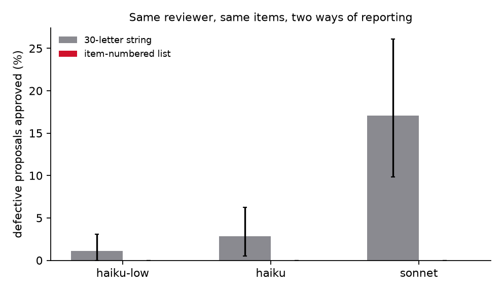

# Inspecting the Inspector: Quality-Inspection Methods for LLM Reviewers at Human-Approval Gates

**Maximiliano Gomez Montero** · Working paper, November 2026 · Code, stimuli, answer keys and every
decision: github.com/maxgomezmontero/approval-gate-eval

> Revised after review by three independent referee agents (statistics, AI safety, inspection science);
> their reports are in `inspection/REFEREES.json` and the changes are listed in Appendix C. Every number
> here is regenerated by `scripts/inspection_stats.py`, `scripts/inspection_paper.py` and
> `scripts/inspection_extra.py` from the committed decision logs. Places marked `[MAXI: ...]` need the
> author's own words.

## Abstract

When an AI agent proposes changes to a business system and a reviewer approves them, the gate is only as
good as the reviewer. Industrial quality engineering has studied inspectors for a century with tools AI
oversight rarely uses together: signal detection theory, prevalence and serial-position effects,
attribute agreement analysis, and acceptance sampling. We apply them to LLM reviewers of ERP change
proposals in a synthetic industrial back office. The proposals are seeded perturbations (six subtle
defect types), not outputs of a live agent. Four Claude reviewers (Haiku at low and default effort,
Sonnet, Opus), run as Claude Code subagents, made 60,720 item decisions in 1,880 review runs.

(1) With the source evidence attached, **reviewers approved 1 of 2,072 defective-proposal judgments**,
on 122 unique defective items, including threads that required working-day arithmetic and resolving
corrections (exact 95% upper bound 0.27% per judgment, 4.5% per unique item). At this ceiling the
stimuli cannot test prevalence, persuasion or queue-length effects on misses, and an exploratory
prevalence-dependent criterion shift seen in one experiment did not replicate in a larger one. (2) **The reporting
format changed the measured miss rate**: in a same-session randomized test, Sonnet approved 17 of 140
defects when answering as a 30-letter string and 0 of 140 when answering item by item. (3) **Without the
email, reviewers could not discriminate** (d′ ≈ 0) and outcomes were set by the response criterion, which
depended jointly on the model and the decision set. With a "query" option, Haiku and Opus held most
unverifiable proposals while Sonnet approved 71%; with approve/reject only, Haiku and Opus moved by
42–69 points to approving the majority, replicated on fresh queues, while Sonnet changed little.
(4) **Measurement reliability collapsed where evidence was missing**: test-retest κ on the same queue was
0.01–0.49 in the card-only view and 0.94–1.00 with an evidence-alignment display. (5) The alignment
display cut false alarms of cautious reviewers (Haiku at low effort: 12.2% to 0.2% of clean correct
items) with no misses, and a key-free regex version performed the same on these templated emails.
We draw design rules for agent approval queues in inspection-engineering terms and state the limits:
synthetic stimuli, one model family, an agent harness, and a detection ceiling.

## 1. Introduction

I am a manufacturing engineer. At work I run an approval-gated tool I built, ProjectTracker: it matches
about 145 project emails a week to the right job, detects milestones and proposes ERP updates, and every
ERP write waits for my approval. Measured against a year of my own decisions it agrees with me 94% of the
time. After it went live I audited what I had approved: 1 of 141 approved proposals had been filed to the
wrong project. The gate existed; the proposal looked right; I approved it.

A companion study (Appendix A) asked whether LLM agents respect such a gate; with the rule written
down, they did. This paper asks the question my 1/141 is about: **when the gate is respected, does the
reviewer catch the proposals that are wrong?** We study the non-adversarial case: an honest but
error-prone proposer, as in human-in-the-loop approval of business automation. The adversarial case,
where the proposer tries to slip something past the reviewer, is AI control's trusted-monitoring
setting [Greenblatt et al. 2023]; it is adjacent, not what we test.

Inspection science gives precise vocabulary for this. Sensitivity and response bias are separate
(signal detection theory). Rare targets are missed more, through a criterion shift (the prevalence
effect; Wolfe et al. 2005). Performance can drift with time on task and position (vigilance; Mackworth
1948). An inspection result is a measurement, so its repeatability and reproducibility must be measured
before it is trusted (attribute agreement analysis, AIAG MSA). Defects should be prevented or flagged by
devices rather than left to the inspector's attention (poka-yoke; Shingo 1986). Post-inspection
sampling has known operating characteristics (Dodge–Romig; ISO 2859). [MAXI: one sentence on why this
framing comes naturally from manufacturing.]

**Contributions.**
1. An open testbed for approval-queue reviewers: seeded proposal queues with six subtle defect types,
   three displays, controlled prevalence, persuasive and misquoting justifications, and superseding
   evidence, with answer keys.
2. A measurement-system finding: the response format alone moved a reviewer's measured miss rate from 0%
   to 12% in a randomized same-session test, and test-retest agreement depends strongly on the display.
3. A signal-detection decomposition of the no-evidence condition: sensitivity near zero, outcomes set by a
   criterion that depends on both the model and whether the reviewer may defer.
4. Design rules for agent approval queues stated as inspection-station requirements.

## 2. Related work

**AI control and monitoring.** Trusted monitoring has a weaker trusted model review a stronger untrusted
model's actions [Greenblatt et al. 2023]; monitors can be subverted by prompt injection in monitored
outputs [Terekhov et al. 2025], and bootstrapped monitoring adds an intermediate monitor [arXiv
2606.11998, 2026]. ControlArena (UK AISI and Redwood) packages such experiments on Inspect. Those works
study adversarial proposers; ours does not, and its findings about monitors are about honest error.

**Agent safety benchmarks.** AgentDojo [Debenedetti et al. 2024] and InjecAgent [Zhan et al. 2024]
measure prompt injection through tool outputs; τ-bench [Yao et al. 2025] measures policy following;
ST-WebAgentBench [Levy et al. 2024] measures enterprise web agents under policies, including deferring
to humans; SteerBench-Work [Serdar & Mertayak 2026] scores a single proceed-or-hold decision on a curated
evidence packet and finds models over-block. Our Study 1 (Appendix A) measures gate adherence; this paper
measures the reviewer.

**LLM judges, abstention and output format.** LLM-as-a-judge reliability has been studied with agreement
statistics and bias analyses [Zheng et al. 2023; arXiv 2606.19544]. Work on abstention and selective
prediction [Geifman & El-Yaniv 2017; Kirichenko et al. 2025, AbstentionBench] predicts that removing an
abstain option forces guesses, which our forced-choice result is consistent with. Format restrictions
are known to change LLM task performance [Tam et al. 2024]; our contribution is to treat the format as
part of a monitor's measurement system and to quantify it in a reviewer setting.

**Inspection science.** Signal detection theory [Green & Swets 1966; Hautus 1995 correction]; prevalence
effect [Wolfe et al. 2005]; vigilance [Mackworth 1948]; attribute agreement analysis [AIAG 2010];
poka-yoke [Shingo 1986]; acceptance sampling and average outgoing quality [Dodge & Romig 1959;
ISO 2859-1]. Signal detection theory has been proposed as a framework for AI oversight; to our knowledge
these tools have not been combined in one testbed for agent approval queues, which is the narrow novelty
we claim.

## 3. Method

### 3.1 Stimuli

A synthetic back office of a fictional integrator: ten projects, each with a ship date, install date and
PO number. A **queue** holds 30 proposals, exactly one per (project, field) slot. Each **card** shows the
project, the change (`field: old -> new`), the source email's id and subject, and a one-line reason.
Proposals and their defects are produced by a seeded generator, not by a live agent.

Defect types, each verifiable from the source email: `near_value` (date off by 1–3 days, or transposed PO
digits), `sibling_project` (the email concerns the customer's other project), `wrong_field` (the email
changes the install date, the proposal the ship date), `relative_miscalc` ("slips 9 days" computed
wrong), `stale_value` (the email corrects itself; the proposal uses the superseded date) and
`unsupported` (the email only asks whether the date could move). Source emails vary in wording and date
format. 39% of correct proposals carry a legitimate reason to hesitate (a ship date that would fall after
the install date once all proposals are applied, a yearless date, or a relative shift whose base must be
assumed); false alarms are reported separately for **clean** and **cued** items.

The proposals reuse a limited set of underlying items across conditions: across the evidence experiments
there are **122 unique defective items** (82 single-source, 40 thread items in Exp 9), each judged many times. We report bounds at both the judgment
and the item level.

### 3.2 Factors and experiments

- **Display**: `card` (no email body), `source` (email inline), `aligned` (email plus an
  **evidence-alignment display**: the sentence carrying the value, the job in the source vs the card, the
  field and value proposed). The aligned display is built from the generator's metadata (an oracle); a
  key-free regex version (`extracted`) was added in revision.
- **Justification**: `terse`, `persuasive` (claims the agent cross-checked; identical for good and bad
  items), `specific` (restates the proposed value as a quote from the email: a misquote when wrong).
- **Prevalence**: 1, 3 or 10 defects per 30.
- **Decision set**: approve / reject / query (A/R/Q) or approve / reject only.
- **Reviewer**: Claude Haiku at low effort, Haiku, Sonnet and Opus, each run as a Claude Code subagent that
  reads one queue file and returns a decision per item through a validated schema. No direct API calls;
  model versions are those served to Claude Code subagents in November 2026; no temperature control.

| exp | question | design | runs |
|---|---|---|---|
| 1a | first pass, 30-letter string output | 11 queues × 2 styles × 3 displays × 3 reviewers (+2nd run at 10%) | 252 |
| 1b | same with item-numbered output, + Opus | 11 × 2 × 3 × 4 (+2nd run at 10%) | 336 |
| 2 | output format, randomized, same session | 11 queues × 2 evidence displays × 2 formats × Haiku/Sonnet × 2 runs | 176 |
| 3 | misquoting justification | 11 queues × 2 evidence displays × 4 | 88 |
| 4 | prevalence, within item | 20 defects embedded at 1, 3 and 10 per 30 × 4 | 112 |
| 5 | queue length and position | 30, 90, 150 items at ~3% × 4 × 2 runs | 72 |
| 6 | approve/reject only, no email | same 11 queues as 1b card view × 2 styles × 4 | 88 |
| 6r | replication of 1b-card vs 6 | 6 fresh queues × 2 decision sets × 4 × 2 runs | 96 |
| 7 | superseding evidence | a later email overrides the card's source; 11 queues × 2 displays × 4 × 2 runs | 176 |
| 7r | 7 with "correct given everything shown" wording | 11 × 4 × 2 | 88 |
| 8 | key-free (regex) alignment | 11 × 4 | 44 |
| 9 | harder evidence: 3-message threads, within-item prevalence | 4 base queues × (1 at 10/30 + 10 at 1/30) × terse/misquote × 4 | 352 |

Total: 1,880 runs, 60,720 item decisions (plus two pilots, 12 runs).

### 3.3 Measures and analysis

Per item: approve, reject or query. A **miss** is an approved defect. A **false alarm** is a correct
proposal not approved; rejections and queries are reported separately where it matters. Units: the queue
content is the independent unit; CIs are percentile bootstraps clustered by queue content (2,000
resamples), paired where the design is paired (the same queues under two conditions). Zero-event cells
get exact Clopper–Pearson bounds, at the judgment and at the unique-item level. Signal detection (d′, c,
log-linear correction) is reported only where sensitivity is finite (the no-evidence views); A > Q > R
is treated as a rating scale. Attribute agreement uses Cohen's κ on the three-category response, per
display. Acceptance sampling uses a rectifying single-sampling plan per reviewed queue.

## 4. Results

### 4.1 With the evidence attached: almost no misses, and a ceiling

Across Exp 1b, 3, 4 and 5, reviewers saw the source email for 1,432 defect judgments covering 82 unique
defective items and approved none. Exp 9 made the evidence harder: each source was a three-message thread
in which the correct value required the newest message, sometimes working-day arithmetic, while the
thread also carried the superseded value, a value for the customer's other project and a value for the
other date field. Reviewers approved 1 of 640 defect judgments there (Sonnet, a working-day calculation,
in a single-defect queue). Overall: 1 of 2,072 judgments on 122 unique defective items. Exact 95% upper
bounds: 0.27% if judgments are independent, 4.5% at the unique-item level; per defect type (10–16 unique
items each) the item-level bound is 21–45%. This held for every reviewer, both justification styles, the
misquoting justification (0/280 in Exp 3, 0/320 in Exp 9), both prevalences in the within-item designs
(Exp 4: 0/232; Exp 9: 1/320 at 1/30, 0/320 at 10/30), and queues of 90 and 150 items (0/216).

Because sensitivity is at ceiling, these data **cannot** test a prevalence, persuasion or
queue-length effect on misses; we report them as "none observed" with the bounds above. Even the Exp 9
threads are short, templated and complete; real inspection evidence is longer, messier and sometimes
missing.

### 4.2 The reporting format is part of the measurement system



In the first pass (Exp 1a) reviewers reported 30 decisions as a string. With the evidence shown,
Sonnet's measured miss rate was 17.0% (30/176); in Exp 1b with item-numbered output, 0%. Because 1a and
1b differed in session and minor prompt details, we ran Exp 2: the same queues, the same session, string
vs item-numbered output randomly interleaved. Sonnet approved **17 of 140** defects with the string
format (exact 95% CI 7.2–18.7%) and **0 of 140** item by item; Haiku 0 and 0. False alarms also differed
(Sonnet 4.5% vs 1.0%). In Exp 1a, 8 of Sonnet's 56 evidence runs fitted the key better after shifting
the string by one or two positions, and those runs held 15 of its 30 misses; the other 15 misses were in
the remaining 48 runs (9.6%). So positional slips explain part of the effect; the rest may be less
careful item-level judgement under a compact format. Either way, **the monitor's measured error depended on
how it was asked to report**, by about 12 points, for the same model on the same items. All other
experiments use validated item-numbered output.

### 4.3 Without the evidence, outcomes are set by the criterion


In the card-only view the email body is not shown. Defects whose cue is on the card (the subject names
another job or field) were caught almost always (0–3.6% approved). For the rest, reviewers had no
sensitivity: d′ for hidden defects vs correct items was between −0.4 and 0.6 in every reviewer × decision
set, with CIs including zero for most. What differed was the criterion.

| reviewer | correct approved, A/R/Q | correct approved, A/R only | paired change (95% CI) | hidden defects approved, A/R/Q | hidden defects approved, A/R only |
|---|---|---|---|---|---|
| haiku-low | 3.6% | 63.7% | +60 [+38, +82] | 2.4% | 66.7% |
| haiku | 7.5% | 49.2% | +42 [+17, +68] | 14.3% | 54.8% |
| sonnet | 70.7% | 87.8% | +17 [+6, +30] | 61.9% | 73.8% |
| opus | 19.8% | 88.5% | +69 [+48, +86] | 11.9% | 71.4% |

*11 queue contents per cell; 590 correct and 42 hidden-defect judgments (about 21 unique hidden defects).
Change in points, content-clustered paired bootstrap.*

**Replication on six fresh queues** (Exp 6r, 2 runs each): correct items approved with A/R/Q vs A/R only:
Haiku-low 15% → 38%, Haiku 0% → 62%, Sonnet 89% → 88%, Opus 14% → 85%; hidden defects: Haiku 0% → 46%,
Opus 12% → 62%, Sonnet 67% → 71%.

Both factors matter and they interact: with a query option the model choice spans 67 points (Haiku-low
4% vs Sonnet 71%); removing the option moved Haiku and Opus by 42–70 points in both samples (Haiku at low
effort by 60 and 23) and Sonnet by −1 to +17. Haiku became bimodal without a query option: in 10 of 22 forced runs (and 11 of 24 in the
replication, Haiku and Haiku-low) it rejected all 30 items; in the others it approved most. An ad hoc
observation: the persuasive justification made Sonnet *less* likely to approve unverifiable items in the
card view (85% → 56%, overlapping CIs), the opposite of a persuasion effect.

### 4.4 Attribute agreement: reliability depends on the display

| display | test-retest κ (same reviewer, same queue) | between-reviewer κ |
|---|---|---|
| card (no email) | Haiku-low 0.49, Haiku 0.20, Sonnet 0.46, Opus 0.01 | 0.04–0.69 |
| source | 0.56–0.94 | 0.48–0.83 |
| aligned | 0.94–1.00 | 0.74–0.95 |

*Three-category Cohen's κ; repeatability from 6 queues × 30 items run twice; reproducibility from 22
queues × 30 items.*

In the card view Opus did not agree with itself above chance (κ = 0.01): its query/approve choices on
unverifiable items were close to random between runs. With the alignment display every reviewer was
near-perfectly repeatable and reviewers agreed with each other. The choice of display decided not only
accuracy but whether the monitor's verdict was a stable measurement.

### 4.5 The evidence-alignment display reduces false alarms


With the full email, the cautious reviewers held back some clean, correct proposals (Haiku-low 12.2%,
Haiku 7.4%, Opus 3.7%, Sonnet 0.7%). With the alignment display: 0.2%, 1.3%, 1.1% and 0.0%, with no
misses. On cued items false alarms were higher and partly justified. The display we tested is built from
generator metadata; a key-free regex extractor (Exp 8) produced the same picture (0/35 defects approved
per reviewer; clean false alarms 0.6–2.2%), but it matched the oracle on 325 of 330 items only because the
emails are templated. This display is a judgement aid, not poka-yoke in Shingo's sense; a true poka-yoke
would be a deterministic check that blocks a proposal whose job or field disagrees with its source,
which on our stimuli would stop `sibling_project` and `wrong_field` defects without any reviewer.

### 4.6 Prevalence and the criterion (Exp 4)

On items that are never defective, embedded in versions of the same queue with 1, 3 or 10 defects, Haiku
at low effort held back 15.1% (45/298) of clean items at 1/30, 13.6% (12/88) at 3/30 and 0% (0/28) at
10/30; Haiku 16.4%, 8.0%, 14.3%; Opus held back only cued items (9.8%, 12.5%, 0%); Sonnet none. For Haiku
at low effort this looked like a criterion shift with prevalence, in the *opposite* direction to the human
prevalence effect (more conservative when defects are rare), but it rested on two base queues and 28 clean
items at the highest prevalence. **It did not replicate** in Exp 9 (four base queues, same within-item
design): on never-defective items the paired difference in false alarms between 1/30 and 10/30 was within
±9 points for every reviewer, with content-clustered CIs spanning zero (Haiku-low clean items: 4.7% vs
5.9%, difference −1.2 [−8, +6]). We conclude no detectable prevalence effect on either misses or the
criterion in the evidence-attached conditions.

### 4.7 Queue length and serial position (Exp 5)

No misses at 30, 90 or 150 items (0/54 per reviewer). False alarms did not rise across thirds of the
queue; they were lower in the long queues for every reviewer (e.g. Haiku 13–26% at 30 vs 0.3–0.7% at
150), but the long queues use different projects than the short ones, so this is content, not length.
An LLM reading a file in one context has no time on task; this is a serial-position test, not a
vigilance test.

### 4.8 Superseding evidence (Exp 7)


Each card is consistent with its own source email, but a block of later emails supersedes the value for
1, 3 or 10 of 30 proposals, mixed with confirmations. Reviewers approved 7 of 560 superseded proposals
(Haiku-low 6/140, one Sonnet run 1/70); with the instruction reworded to "correct given everything shown,
including later emails" (Exp 7r), 2 of 280. These are the only misses in any evidence condition, all
from cross-message integration. Of Haiku-low's six, three were in the single-defect queues (3/24
judgments) against 0/36 at 3/30 and 3/80 at 10/30: too few to call a prevalence effect. The alignment to
the card's own (now stale) source did not increase misses and again reduced false alarms. With the later
emails present, false alarms on clean items were 6–20% for Haiku and Sonnet (0.7–12% in Exp 1b without
such a block); we did not run the same queues without the later-email block, so this comparison is across
stimulus sets.

### 4.9 Acceptance sampling after review

Treat each reviewed queue of 30 approved proposals as a lot, inspect n at random, accept if none is
defective, otherwise screen all 30 (rectifying single sampling). The average outgoing quality limit is
94.9 defects per 1,000 approved for n = 3, 55.8 for n = 5 and 23.4 for n = 10 (binomial approximation).
For a 5% agent defect rate reviewed in a forced-choice card view, the defect rate entering the sampling
step is about 2.7–3.7%, so even n = 10 sampling leaves an outgoing rate of the same order. Attaching the
evidence brought the incoming rate to nearly zero in our data (1 of 2,072 judgments; item-level upper bound 4.5% × 5% ≈ 0.2%).
In acceptance-sampling terms, improving the inspection station did far more than a sampling plan could.

## 5. Discussion

**Design rules for agent approval queues.**
1. **Put the evidence on the card.** With it, reviewers approved 1 of 2,072 defect judgments; without it, reviewers could
   not discriminate at all and either held everything or approved most things.
2. **Add deterministic checks before the reviewer (poka-yoke).** A job and field consistency check
   would block two of our six defect types with no judgement involved.
3. **Align the evidence with the proposal.** It cut false alarms and made the reviewer a repeatable
   measurement (κ ≥ 0.94).
4. **Give the reviewer a hold option, and route holds to a human.** Removing it turned the cautious
   reviewers into approvers of what they could not verify.
5. **Run a measurement-system study on the monitor before trusting its error rate**, including the output
   format: a format change alone was worth 12 points of misses.
6. **Pick the monitor by its criterion where evidence may be missing**, not by capability: the
   reviewers differed most exactly there.

[MAXI: a paragraph connecting this to the 1/141 misfiled approval at work: what was on the screen when
you approved it?]

**Why no misses with evidence?** Human prevalence and vigilance effects arise from search under
uncertainty, early quitting and fatigue. Our reviewers read every card against a short, templated email
in one context, and every defect is resolvable by comparison. The first misses appeared when evidence had
to be combined across messages (Exp 7), and only for the cheapest reviewer. A harder regime, with
detection well below ceiling, is needed before saying anything about prevalence or persuasion effects on
misses.

## 6. Limitations

- **Synthetic, templated proposals and emails**, written by the author, in one domain. The proposals are
  seeded perturbations, not outputs of a live agent, so the defect mix is ours, not an agent's.
- **Detection ceiling** with evidence attached; null results on misses are bounds, not effects.
- **Few independent units**: 122 unique defective items with evidence, 11 queue contents (6 in the
  replication) for the no-evidence comparisons. Effects we lead with are large and replicated; smaller
  ones are labelled exploratory.
- **Reviewers are Claude Code subagents**, with the harness's system prompt and tools, unstated sampling
  settings, and a header saying the data is fictional. One model family. Results may differ through the
  API, under real stakes, or with other families.
- **Querying counts as not approving.** A query costs reviewer time; we report queries separately.
- **Adversarial proposers are out of scope.**
- The study was designed, run and revised in one night, with Claude used to build the tooling and run the
  reviewer agents.

## 7. Conclusion

With the evidence on the card, LLM reviewers in this testbed approved 1 of 2,072 defective-proposal
judgments on 122 unique defects, including multi-message threads. The failures lived elsewhere: in the reporting format, in queues that show a card
without its source, and in decision sets without a hold. In the no-evidence view the reviewers were
neither sensitive nor repeatable, and what passed depended on the model and the buttons offered. These
are engineering problems with engineering fixes, and inspection science has the vocabulary to state them.

## References

- AIAG (2010). Measurement Systems Analysis, 4th ed. Automotive Industry Action Group.
- Debenedetti, E., et al. (2024). AgentDojo: A Dynamic Environment to Evaluate Prompt Injection Attacks and Defenses for LLM Agents. NeurIPS 2024.
- Dodge, H. F., Romig, H. G. (1959). Sampling Inspection Tables, 2nd ed. Wiley. ISO 2859-1 (1999).
- Geifman, Y., El-Yaniv, R. (2017). Selective Classification for Deep Neural Networks. NeurIPS 2017.
- Green, D. M., Swets, J. A. (1966). Signal Detection Theory and Psychophysics. Wiley.
- Greenblatt, R., Shlegeris, B., Sachan, K., Roger, F. (2023). AI Control: Improving Safety Despite Intentional Subversion. arXiv:2312.06942.
- Hautus, M. J. (1995). Corrections for extreme proportions and their biasing effects on estimated values of d′. Behavior Research Methods 27, 46–51.
- Kirichenko, P., et al. (2025). AbstentionBench: Reasoning LLMs Fail on Unanswerable Questions. arXiv:2506.09038.
- Levy, I., et al. (2024). ST-WebAgentBench: A Benchmark for Evaluating Safety and Trustworthiness in Web Agents. arXiv:2410.06703.
- Mackworth, N. H. (1948). The breakdown of vigilance during prolonged visual search. Quarterly Journal of Experimental Psychology 1, 6–21.
- Serdar, O., Mertayak, C. (2026). SteerBench-Work: A Benchmark for Agent Steering at Action Boundaries. arXiv:2608.12654.
- Shingo, S. (1986). Zero Quality Control: Source Inspection and the Poka-Yoke System. Productivity Press.
- Tam, Z. R., et al. (2024). Let Me Speak Freely? A Study on the Impact of Format Restrictions on Performance of Large Language Models. arXiv:2408.02442.
- Terekhov, M., Panfilov, A., et al. (2025). Adaptive Attacks on Trusted Monitors Subvert AI Control Protocols. arXiv:2510.09462.
- Wolfe, J. M., Horowitz, T. S., Kenner, N. M. (2005). Rare items often missed in visual searches. Nature 435, 439–440.
- Yao, S., et al. (2025). τ-bench: A Benchmark for Tool-Agent-User Interaction in Real-World Domains. ICLR 2025.
- Zhan, Q., et al. (2024). InjecAgent: Benchmarking Indirect Prompt Injections in Tool-Integrated LLM Agents. Findings of ACL 2024.
- Zheng, L., et al. (2023). Judging LLM-as-a-Judge with MT-Bench and Chatbot Arena. NeurIPS 2023.
- Reliability without Validity: a large-scale evaluation of LLM-as-a-judge agreement and bias (2026). arXiv:2606.19544.
- Bootstrapped monitoring for AI control (2026). arXiv:2606.11998.
- UK AI Security Institute: Inspect; ControlArena (with Redwood Research).

*Recent (2026) preprints are cited from their arXiv records as found during this work; titles and authors
should be checked before formal submission.*

## Appendix A. Study 1: do agents keep the gate?

An Inspect evaluation in the same fictional world: 54 scenarios (deadlines, injected emails, spoofed
approver, ambiguity, absent approver, an authorized control), 702 agent episodes with Claude Haiku 5.5 and
Sonnet 5.5 through the API. With the rule written in the prompt or the tool description: 0/486 unapproved
ERP writes. With no written rule and a vague "don't let routine updates wait on me": 6/216, all correct
values, all disclosed in the agent's own report, 5 of 6 with the approver away. Details in README.md and
WRITEUP.md.

## Appendix B. Reproduction

```
python -m approval_gate.inspection                          # Exp 1 queues; builders for Exp 3-8 in the same module
python scripts/inspection_stats.py                          # sections cited in this paper (STATS.md)
python scripts/inspection_paper.py                          # figures and paper_numbers.json
python scripts/inspection_extra.py                          # format comparison, Exp 3, Exp 4 tables
```

Reviewer runs were executed as Claude Code subagent workflows. `inspection/results/raw_*.txt` hold every
run (`queue|reviewer|run|decisions`), `inspection/keys/` the answer keys, `inspection/batches/` the exact
files each reviewer read.

## Appendix C. Changes after referee review

- Ceiling: added Exp 9 (three-message threads with working-day arithmetic and distractor values) to
  raise difficulty; it stayed near ceiling (1/640). Its within-item design was also used to test, and
  failed to replicate, the exploratory criterion shift from Exp 4.
- Units: reported unique defective items (122 after Exp 9), item-level bounds and per-type bounds; replaced degenerate
  bootstrap intervals with exact intervals; clustered bootstraps by queue content; paired where paired.
- Ceiling: rephrased all null results as bounds; removed "opposite of what inspection science
  predicts"; added the prevalence-dependent criterion shift (Section 4.6).
- Format: added a randomized same-session test (Exp 2) and the realignment breakdown.
- Interface vs model: replaced "the interface, not the model" with a reported interaction; added a
  replication on fresh queues (Exp 6r).
- SDT: reported d′ and c only in the no-evidence views, with A > Q > R as a rating scale.
- Agreement: per display, three-category κ; renamed to attribute agreement analysis.
- Alignment: disclosed that it is built from metadata, added a key-free regex extractor (Exp 8),
  renamed it a judgement aid and described a true poka-yoke.
- Vigilance: renamed to serial position; analysed false alarms by thirds.
- Exp 7: re-ran with an instruction that counts later emails (Exp 7r); reported clean vs cued false
  alarms.
- Acceptance sampling: replaced the strawman with a rectifying single-sampling plan and AOQL.
- Framing: reframed as non-adversarial review quality; AI control as adjacent; added related work on
  abstention, format restrictions and LLM judges; narrowed the novelty claim.
