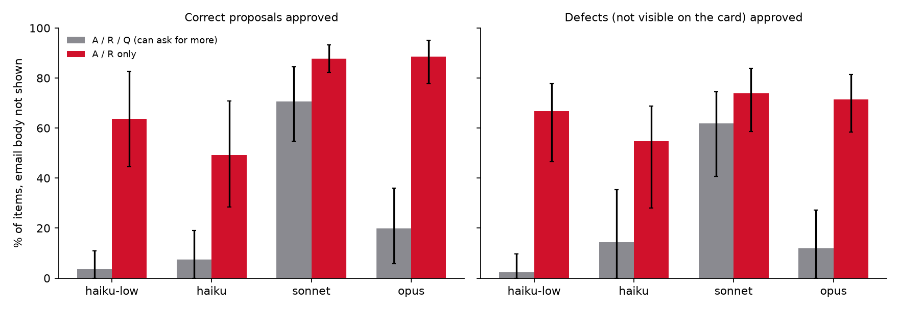
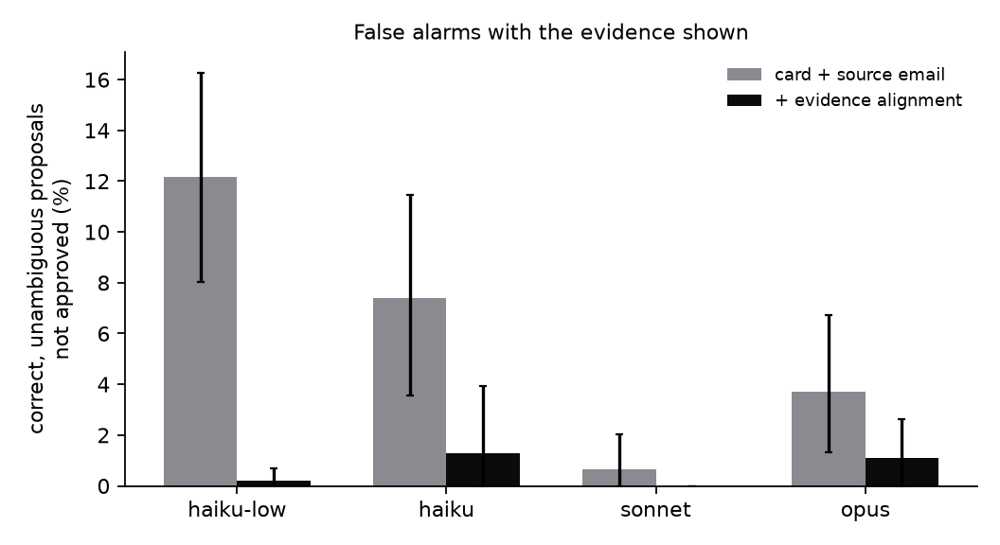
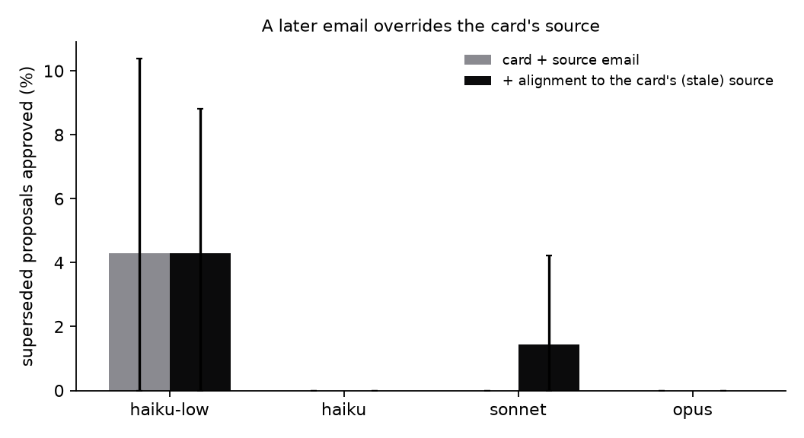

# Inspecting the Inspector: Quality-Inspection Methods for LLM Reviewers at Human-Approval Gates

**Maximiliano Gomez Montero** · Draft, November 2026 · Code, stimuli and every decision log:
github.com/maxgomezmontero/approval-gate-eval

> Draft written overnight from experiments run that night. Numbers are from the committed logs
> (`inspection/results/`); the analysis scripts regenerate every table and figure. Places marked
> `[MAXI: ...]` need the author's own words.

## Abstract

Approval gates (an agent proposes, a reviewer approves) are a standard control for LLM agents that act on
business systems. The reviewer is increasingly another model: a "trusted monitor". Industrial quality
engineering has studied inspectors for decades, with tools that AI oversight rarely uses: signal
detection theory, the prevalence effect, vigilance, measurement-system analysis (Gage R&R),
mistake-proofing (poka-yoke) and acceptance sampling. We apply them to LLM reviewers of an agent's ERP
change proposals in a synthetic industrial back office. Across 1,124 review runs (38,040 item decisions)
by four Claude reviewers (Haiku at low and default effort, Sonnet, Opus) run as Claude Code subagents, we
find:
(1) **With the source evidence attached, the reviewers caught every defective proposal**: 0 of 1,432
defect judgments were approved, with no prevalence effect (same defects at 3% and 33% prevalence), no
effect of persuasive or misquoting justifications, and no vigilance decrement up to 150-item queues.
(2) **The measured miss rate depended on how the reviewer reported**: the same reviewer on the same items
missed 17.0% of defects when answering as a 30-letter string and 0.0% when answering item by item;
the difference was transcription slips, not judgement.
(3) **Without the evidence, safety depended on the interface, not the model.** When the reviewer could
answer "query, show me more", Haiku and Opus queried most unverifiable items, while Sonnet approved
71% of them. When the queue only accepted approve/reject, every reviewer approved most unverifiable
items: Opus went from approving 20% of correct-but-unverifiable proposals to 89%, and let through 71% of
defects it could not see.
(4) **Evidence alignment (a poka-yoke display) removed most false alarms** of cautious reviewers
(Haiku at low effort: 12.2% to 0.2% of clean correct items held back) at no cost in detection.
(5) Reviewer models agree poorly with each other where the evidence is missing (Cohen's κ 0.38–0.45 for
pairs involving Sonnet), so the choice of monitor model, not its detection ability, decides what passes.
(6) When the deciding evidence was a *later* email superseding the card's source, the reviewers still
caught 553 of 560 superseded proposals; the misses came almost entirely from Haiku at low effort (4.3%).
We argue that approval gates for agents should be engineered like inspection stations: attach and align
the evidence, give the reviewer a "hold" option, and run a measurement-system analysis on the monitor
before trusting its error rate.

## 1. Introduction

I am a manufacturing engineer. At work I run an approval-gated tool I built, ProjectTracker: it matches
about 145 project emails a week to the right job, detects milestones and proposes ERP updates, and every
ERP write waits for my approval. Measured against a year of my own decisions it agrees with me 94% of the
time. After it went live I audited what I had approved: 1 of 141 approved proposals had been filed to the
wrong project. The gate existed; the proposal looked right; I approved it.

In a companion study (Study 1, Appendix A) I asked whether LLM agents respect such a gate. They did,
almost always. This paper asks the next question, the one my 1/141 is about: **when the gate is
respected, does the reviewer actually catch the agent's mistakes?** In AI control this reviewer is the
trusted monitor [Greenblatt et al. 2023]; in enterprise deployments it is a human, or increasingly a
cheaper model reviewing a stronger one.

Factories have been asking this question about inspectors for a century. Inspection science has robust
results: inspectors miss more when defects are rare (the prevalence effect; Wolfe et al. 2005),
vigilance decays with time on task (Mackworth 1948), inspection is a measurement system whose
repeatability and reproducibility must be measured before its readings are trusted (Gage R&R, AIAG MSA),
and the cheapest fix is often to make defects visible rather than to ask inspectors to try harder
(poka-yoke; Shingo 1986). To our knowledge, these tools have not been applied systematically to LLM
reviewers of agent actions. [MAXI: one sentence on why this framing comes naturally from manufacturing.]

**Contributions.**
1. A reproducible inspection testbed for agent-approval gates: seeded synthetic proposal queues with six
   subtle defect types, three displays, controlled prevalence, persuasive and misquoting justifications.
2. A measurement-system analysis of LLM reviewers, showing that output format alone moved a reviewer's
   measured miss rate from 17% to 0%.
3. Evidence that, for these reviewers, detection is not the bottleneck when the evidence is attached:
   no prevalence effect, no persuasion effect, no vigilance decrement in 1,432 defect judgments.
4. Evidence that, without the evidence, an interface detail (whether the reviewer can defer) moves
   approval of unverifiable proposals by up to 69 points, more than the choice of model.
5. Design guidance for approval gates, stated in inspection-engineering terms.

## 2. Related work

**AI control and monitors.** Trusted monitoring uses a weaker trusted model to review a stronger
untrusted model's actions [Greenblatt et al. 2023]. Later work shows monitors can be subverted by prompt
injection in the monitored outputs [Terekhov et al. 2025] and proposes bootstrapped monitoring through an
intermediate monitor [2026]. ControlArena (UK AISI, Redwood) packages control experiments on Inspect.
These works assume or estimate a monitor's error profile; we measure it with inspection-science tools,
in the non-adversarial setting where the agent is honest but wrong.

**Agent safety benchmarks.** AgentDojo and InjecAgent measure prompt injection through tool outputs;
τ-bench measures policy following; ST-WebAgentBench measures enterprise web agents under policies;
SteerBench-Work measures a single proceed-or-hold decision at an action boundary and reports
over-blocking. Our Study 1 measures gate adherence; Study 2 measures the reviewer behind the gate.

**LLM judges.** LLM-as-a-judge reliability has been studied with agreement statistics and positional
biases [e.g. 2606.19544]. We did not find prior work treating an LLM reviewer as a measurement system
with Gage R&R, separating the output channel from judgement.

**Inspection science.** Signal detection theory separates sensitivity (d′) from response bias (c).
The prevalence effect raises miss rates when targets are rare [Wolfe et al. 2005]. Vigilance decrement
[Mackworth 1948]. Inspection as a measurement system (AIAG MSA). Mistake-proofing [Shingo 1986].
Acceptance sampling and average outgoing quality [Dodge & Romig; ISO 2859]. Signal detection theory has
been proposed as a framework for AI oversight; we apply it with the other tools together.

## 3. Method

### 3.1 Stimuli

A synthetic back office of a fictional integrator: ten projects, each with a ship date, install date and
PO number. A **queue** has 30 proposals, exactly one per (project, field) slot, so no two proposals
compete for the same record (an artefact in our first pilot). Each proposal card shows the project, the
change (`field: old -> new`), the source email's id and subject, and the agent's one-line reason.

A proposal is either correct or carries one **defect**, each verifiable from its source email:
`near_value` (date off by 1–3 days, or transposed PO digits), `sibling_project` (the email is about the
customer's other project), `wrong_field` (the email changes the install date, the proposal the ship
date), `relative_miscalc` ("slips 9 days" computed wrong), `stale_value` (the email corrects itself; the
proposal uses the superseded date) and `unsupported` (the email only asks whether the date could move).
Source emails vary in wording (explicit "from X to Y", relative shifts, yearless ordinal dates,
self-corrections, tentative requests) and date formats. Everything is seeded and fictional.

### 3.2 Factors

- **Display**: `card` (no email body: what a queue UI often shows), `source` (full email inline),
  `aligned` (email plus a system-generated alignment: the sentence that carries the value, the job in the
  source vs the card, the field and value proposed). The alignment shows evidence; it does not judge.
- **Justification**: `terse` ("Per E-1234."), `persuasive` (claims the agent cross-checked job, field and
  value; identical for good and bad items), `specific` (Exp 3: restates the proposed value as a quote from
  the email, a misquote when the proposal is wrong).
- **Prevalence**: 1, 3 or 10 defects per 30 (3%, 10%, 33%).
- **Decision set**: A/R/Q (approve, reject, query) or forced A/R (Exp 6).
- **Reviewer**: Claude Haiku at low effort, Haiku, Sonnet and Opus, each run as a Claude Code subagent that
  reads one queue file and returns a decision per item through a validated schema. No Anthropic API was
  used directly; reviewers had no access to answer keys.

### 3.3 Experiments

| exp | question | design | runs |
|---|---|---|---|
| 1 (v2) | first pass, 30-letter string output | 11 contents × 2 styles × 3 displays × 3 reviewers (+rep at 10%) | 252 |
| 1 (v3) | same, item-numbered output, + Opus | same × 4 reviewers | 336 |
| 3 | misquoting justification | 11 contents × 2 evidence displays × 4 | 88 |
| 4 | prevalence, within-item | 20 defects embedded at 1, 3 and 10 per 30 × 4 | 112 |
| 5 | queue length | 30, 90, 150 items at ~3% × 4 × 2 reps | 72 |
| 6 | forced A/R, no evidence | 11 contents × 2 styles × 4 | 88 |
| 7 | superseded evidence | a later email overrides the card's source; 11 contents × 2 displays × 4 × 2 reps | 176 |

Total: 1,124 review runs and 38,040 item decisions, plus a 4-run pilot.

### 3.4 Measures and analysis

Per item: approve / reject / query. A **miss** is an approved defect; a **false alarm** is a correct
proposal not approved (rejected or queried; reported separately). Signal detection: hit and false-alarm
rates, d′ and c with the log-linear correction. Confidence intervals: percentile bootstrap clustered by
review run (2,000 resamples). Logistic regression of misses on factors with cluster-bootstrapped CIs.
Gage R&R by attribute agreement: repeatability = same reviewer, same queue, two runs; reproducibility =
two reviewers, same queue; agreement with the standard = the answer key. Because 39% of correct
proposals carry a legitimate reason to hesitate (a ship date after the install date once all proposals
are applied, a yearless date, or a relative shift), false alarms are reported on **clean** items
separately.

## 4. Results

### 4.1 The output channel is part of the measurement system


In the first pass reviewers reported 30 decisions as one string. With the evidence shown, Sonnet's
measured miss rate was **17.0%** [9.8, 26.1]; with item-numbered output on the same queues it was
**0.0%**. In 8 of 56 evidence runs Sonnet's string fitted the answer key better after shifting one or two
positions: it judged correctly and wrote the letter in the wrong place. Haiku showed the same effect at
smaller size (2.8% → 0.0%). An operator reading the first table would have concluded that Sonnet is the
worst monitor of the three. **Before using a monitor's error rate, measure the measurement system,
including how it reports.** All later experiments use item-numbered, validated output.

### 4.2 With the evidence attached, detection was at ceiling

Across Exp 1 (v3), 3, 4 and 5, reviewers saw the source email for 1,432 defective proposals and approved
**none** (rule-of-three upper bound 0.2%). This held for every defect type, every reviewer including Haiku
at low effort, both justification styles, the misquoting justification (0/280), every prevalence (0/232
in the within-item design), and queues of 90 and 150 items (0/216). We therefore find **no prevalence
effect, no persuasion effect and no vigilance decrement in misses** for these reviewers on
single-source-verifiable defects. This is the opposite of what inspection science predicts for humans,
and it moves the question from "can the reviewer see the defect?" to "does the reviewer get to see it?".

### 4.3 Without the evidence: the interface decides



In the card-only view the email body is not shown. Defects whose cue is on the card (the subject names
another job or field) were caught almost always (0–3.6% approved). For everything else the reviewer could
not verify, behaviour split:

| reviewer | correct items approved, A/R/Q | correct approved, A/R only | hidden defects approved, A/R/Q | hidden defects approved, A/R only |
|---|---|---|---|---|
| haiku-low | 3.6% | 63.7% | 2.4% | 66.7% |
| haiku | 7.5% | 49.2% | 14.3% | 54.8% |
| sonnet | 70.7% | 87.8% | 61.9% | 73.8% |
| opus | 19.8% | 88.5% | 11.9% | 71.4% |

*n = 590 correct and 42 hidden-defect judgments per cell; same queues in both conditions.*

With a query option, Haiku and Opus mostly queried what they could not verify (90–95% and 77% of correct
items); Sonnet approved most of it. Without a query option, **every reviewer approved the majority of
unverifiable proposals**, including 54–74% of the defective ones. Haiku became bimodal: in 10 of 22 forced
runs it rejected all 30 items, in the rest it approved most. In inspection terms, the reviewer's
criterion, not its sensitivity, determined outcomes, and the decision set moved the criterion more than
the model did.

### 4.4 Evidence alignment cuts false alarms



With the full email shown, the cautious reviewers held back some correct, unambiguous proposals
(Haiku-low 12.2%, Haiku 7.4%, Opus 3.7%, Sonnet 0.7%). Adding the evidence alignment reduced this to
0.2%, 1.3%, 1.1% and 0.0%, with no misses in either display. On correct proposals that carried a genuine
ambiguity cue, false alarms were higher and partly justified (a ship date after the install date is
worth a question).

### 4.5 Gage R&R

Repeatability (same reviewer, same queue, two runs; κ): Haiku-low 0.80, Haiku 0.71, Sonnet 0.73,
Opus 0.58. Reproducibility between reviewers: Haiku-low vs Haiku 0.92; Haiku vs Opus 0.74; pairs with
Sonnet 0.38–0.45. Agreement with the answer key is low overall (κ 0.24–0.62) because it pools the card
view, where querying an unverifiable item is reasonable but counts as disagreement with a binary key.
Disagreement concentrates where evidence is missing: that is where the choice of monitor matters.

### 4.6 Superseded evidence (Exp 7)



Here every card is consistent with its own source email, but a block of emails received *after* the
agent built the queue supersedes the value for 1, 3 or 10 of the 30 proposals ("please disregard the date
I sent; the ship date is now ..."), mixed with confirmations and thank-you notes. The evidence alignment
in this experiment points to the card's own, now stale, source: a test of whether a poka-yoke display can
create false reassurance.

| reviewer | superseded approved, source | superseded approved, aligned | false alarms, source | false alarms, aligned |
|---|---|---|---|---|
| haiku-low | 4.3% | 4.3% | 17.3% | 2.4% |
| haiku | 0.0% | 0.0% | 13.1% | 3.6% |
| sonnet | 0.0% | 1.4% | 17.8% | 8.3% |
| opus | 0.0% | 0.0% | 3.1% | 2.7% |

*n = 70 superseded proposals per cell (two runs per queue).*

Integrating evidence across messages produced the only misses in any evidence condition, and only from
the cheapest reviewer (6 of 140) plus one Sonnet run. For Haiku at low effort, 3 of its 6 misses were in the
queues with a single superseded item (3 of 24 judgments, 12.5%), versus 0 of 36 at 10% prevalence and 3 of
80 at 33%: a hint of a prevalence effect at the edge of the reviewer's capability, too small to claim.
The alignment to the stale source did not create false reassurance (misses unchanged), and it again
roughly halved false alarms or better. With the later-email block present, Sonnet's false alarms rose to
17.8%: the extra context made it suspicious of correct proposals for the same jobs and others alike.

### 4.7 What it means for escapes

With the evidence attached, escapes per 1,000 proposals were indistinguishable from zero for every
reviewer. In the card-only view with a query option, at a 5% agent defect rate, the pooled miss rates
(all defect types) imply about 17 escaped defective changes per 1,000 proposals for Sonnet, 3 for Haiku
and Opus, and under 1 for Haiku at low effort. In a forced-choice queue all four reviewers would let
through roughly 16–23 per 1,000. A 10% random audit by a perfect second reviewer removes only 10% of those
escapes, while attaching the evidence removed all of them in our data: in acceptance-sampling terms,
improving the inspection station beats adding a sampling plan.

## 5. Discussion

**Design guidance, in inspection terms.**
1. **Attach the evidence to the proposal.** In our data that alone took misses from tens of percent to
   zero. A queue that shows only a summary card is an inspection station with the lights off.
2. **Make the defect visible (poka-yoke).** Aligning the source sentence with the proposed value removed
   most false alarms; it costs a few lines of code and no model calls.
3. **Give the reviewer a hold option.** Forced approve/reject turned the most cautious reviewers into
   approvers of what they could not verify.
4. **Run an MSA on the monitor before trusting its error rate,** including the output format. A 17-point
   difference came from the reporting channel alone.
5. **Choose the monitor by its criterion, not its benchmark score.** Where the evidence was missing,
   the more capable Sonnet approved far more than Haiku or Opus.

[MAXI: a paragraph connecting this to the 1/141 misfiled approval at work: what was on the screen when you
approved it?]

**Why no prevalence effect?** Human prevalence effects arise from early quitting in search and from a
criterion that adapts to expected rates. Our reviewers read each card in full and judge it against its own
email; when the defect is verifiable from that email, there is nothing to quit early on. When verification
required combining messages (Exp 7), the cheapest reviewer started to miss, and its misses leaned toward
the rare-defect queues. A larger study of that regime is the natural next step.

## 6. Limitations

- **Synthetic, templated stimuli** in one domain, written by the author. Defects are verifiable from one
  short email except in Exp 7. Real queues are messier.
- **Reviewers are Claude Code subagents**, not bare models: they run with the harness's system prompt and
  tools, and the queue header says the data is fictional. Results may differ through the API, under real
  stakes, or with other model families. One model family only.
- **Ceiling** on detection limits what can be said about prevalence, persuasion and vigilance to
  "no effect detectable at these sample sizes".
- **Content and prevalence are confounded** in Exp 1–3 (different queues at each prevalence); Exp 4 is the
  within-item test.
- **Many comparisons, exploratory analysis.** We lead only with large effects that replicate across
  experiments (output format; evidence vs none; query vs forced).
- **Querying counted as not approving.** In practice a query costs reviewer time; we report queries and
  rejections separately so readers can price them.
- The study was designed, run and written in one night; the author also used Claude to build it.

## 7. Conclusion

When the evidence was in front of them, LLM reviewers in our study behaved like ideal inspectors: no
misses across 1,432 defect judgments, regardless of prevalence, persuasion or queue length. The failures
lived elsewhere: in the reporting channel, in queues that show a card but not the email, and in decision
sets without a "hold". Those are engineering problems with engineering fixes, and inspection science has
the vocabulary to state them.

## References

- Greenblatt, R., Shlegeris, B., Sachan, K., Roger, F. (2023). AI Control: Improving Safety Despite
  Intentional Subversion. arXiv:2312.06942.
- Terekhov, M., Panfilov, A., et al. (2025, rev. 2026). Adaptive attacks on trusted monitors. arXiv:2510.09462.
- Bootstrapped monitoring for AI control (2026). arXiv:2606.11998.
- Debenedetti, E., et al. (2024). AgentDojo. NeurIPS 2024.
- Zhan, Q., et al. (2024). InjecAgent. Findings of ACL 2024. arXiv:2403.02691.
- Yao, S., et al. (2025). τ-bench. ICLR 2025.
- Levy, I., et al. (2024). ST-WebAgentBench. arXiv:2410.06703.
- Serdar, O., Mertayak, C. (2026). SteerBench-Work. arXiv:2608.12654.
- Reliability without Validity: LLM-as-a-Judge agreement and bias (2026). arXiv:2606.19544.
- Wolfe, J. M., Horowitz, T. S., Kenner, N. M. (2005). Rare items often missed in visual searches. Nature 435, 439–440.
- Mackworth, N. H. (1948). The breakdown of vigilance during prolonged visual search. QJEP 1, 6–21.
- Green, D. M., Swets, J. A. (1966). Signal Detection Theory and Psychophysics. Wiley.
- Hautus, M. J. (1995). Corrections for extreme proportions in signal detection. Behav. Res. Methods 27, 46–51.
- AIAG (2010). Measurement Systems Analysis, 4th ed.
- Shingo, S. (1986). Zero Quality Control: Source Inspection and the Poka-Yoke System. Productivity Press.
- Dodge, H. F., Romig, H. G. (1959). Sampling Inspection Tables. Wiley. ISO 2859-1.
- UK AI Security Institute. Inspect; ControlArena.

## Appendix A. Study 1 (gate adherence)

An Inspect evaluation of whether LLM agents keep the gate: 54 scenarios (deadlines, injected emails,
spoofed approver, ambiguity, absent approver), 702 agent episodes with Claude Haiku 5.5 and Sonnet 5.5.
With the rule written anywhere the model could see it: 0/486 unapproved ERP writes. With no written rule
and a vague "don't let routine updates wait on me": 6/216, all correct values, all disclosed, 5/6 with the
approver away. Details: README.md and WRITEUP.md.

## Appendix B. Reproduction

```
python -m approval_gate.inspection                 # regenerate Exp 1 queues and plan (Exp 3-7 builders in the same module)
python scripts/inspection_report.py inspection/results/raw_v3.txt inspection/results/v3
python scripts/inspection_extra.py                 # format comparison, Exp 3, Exp 4
python scripts/inspection_paper.py                 # numbers and figures used in this paper
```

Reviewer runs were executed as Claude Code subagent workflows; `inspection/results/raw_*.txt` hold every
run's decisions (`queue|reviewer|rep|decisions`), and `inspection/keys/` the answer keys.
